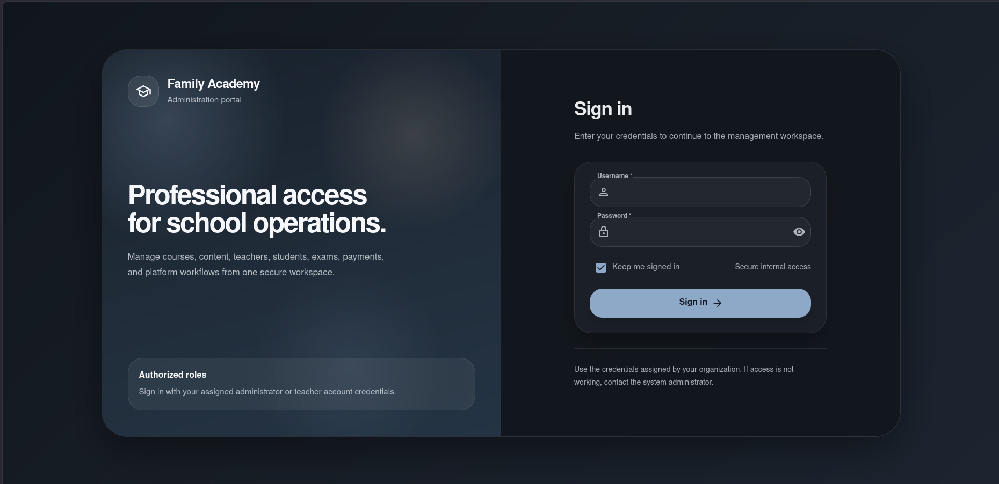
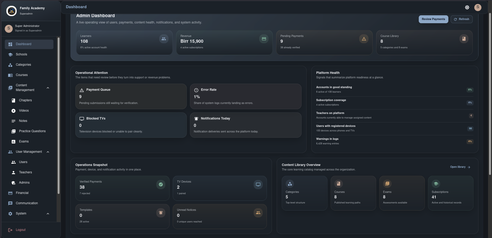
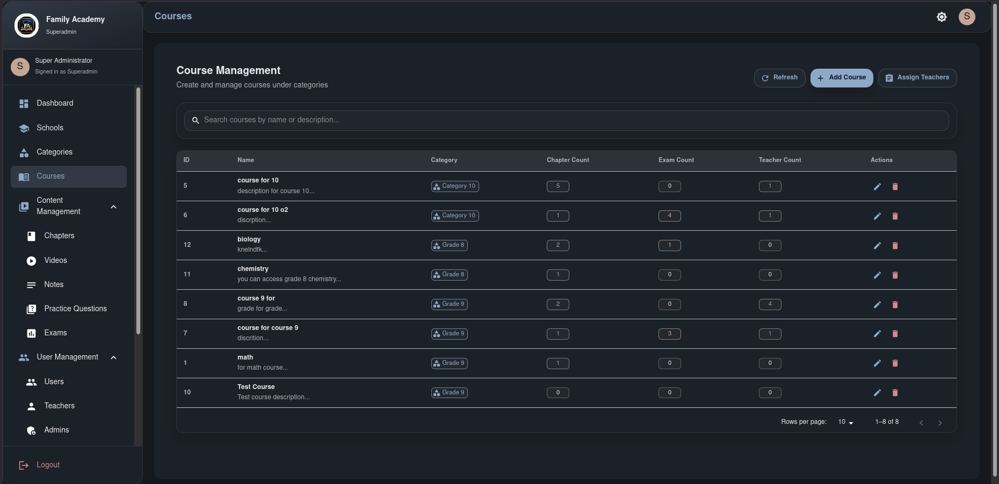
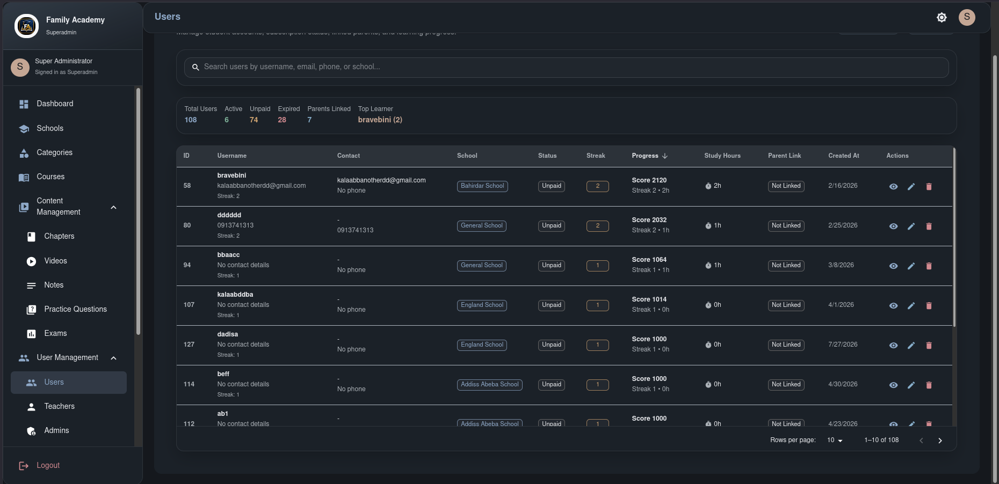
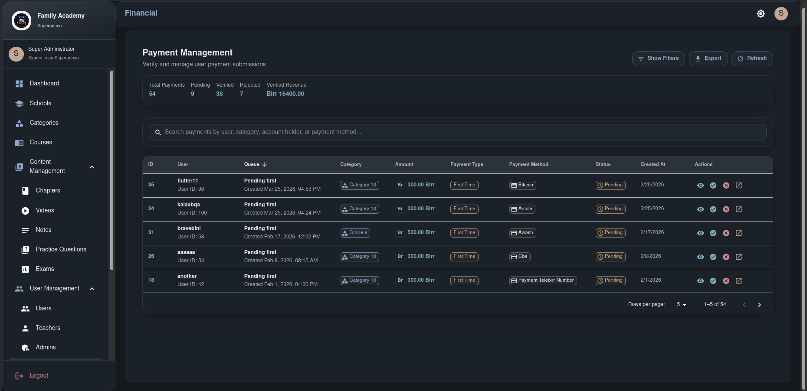
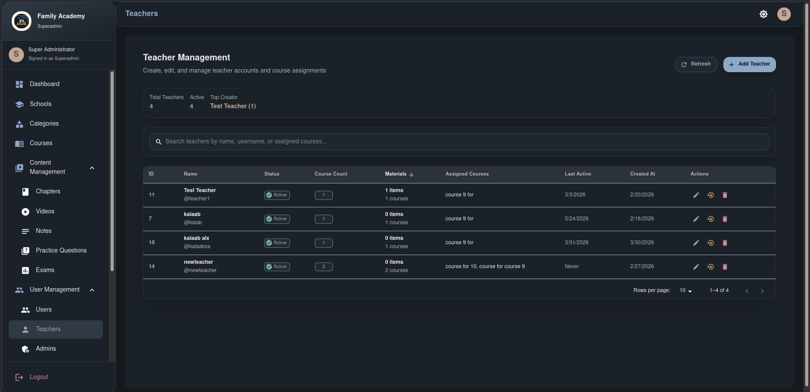
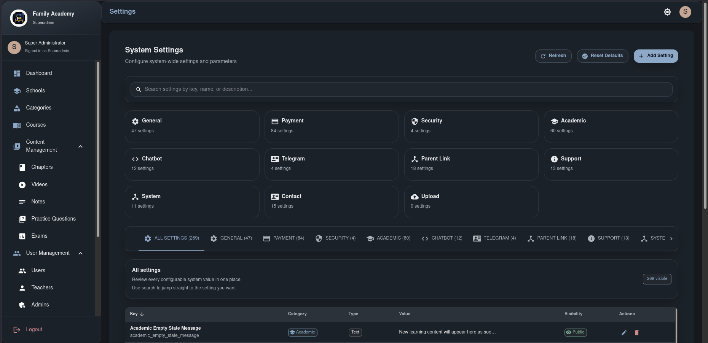
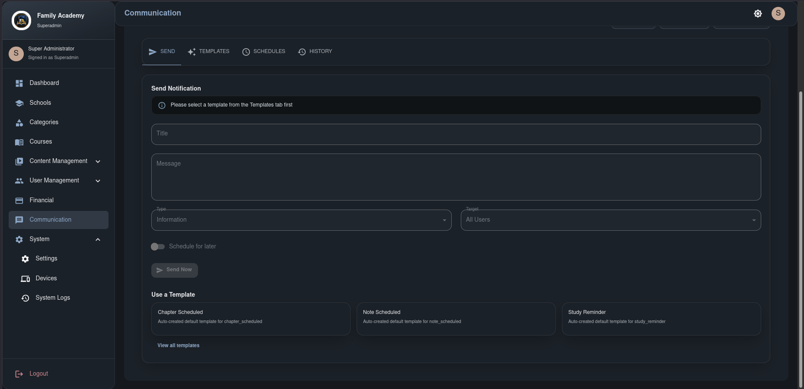

# Family Academy Admin Panel

Admin and teacher dashboard for Family Academy Learning Management System.

This dashboard is one part of the broader Family Academy system:

- Student mobile app
- TV app
- Backend API
- Public landing page

## Features

- **Authentication** - Secure login with JWT tokens and remember me functionality
- **Dashboard** - Real-time statistics and system overview
- **School Management** - CRUD operations for schools
- **Category Management** - Manage course categories with images
- **Course Management** - Create and assign courses to teachers
- **Chapter Management** - Organize content by chapters
- **Video Management** - Upload and manage video content
- **Note Management** - Rich text editor for study notes
- **Question Management** - Create practice questions with batch upload
- **Exam Management** - Create exams and manage questions
- **Payment Management** - Verify and manage user payments
- **User Management** - View and manage user accounts
- **Teacher Management** - Manage teacher accounts and assignments
- **Device Management** - Monitor and manage user devices
- **Settings Management** - Configure system settings
- **System Logs** - Monitor system activity
- **Communications** - Send notifications and Telegram messages

## Screenshots

Real screenshots from the running admin dashboard are stored in [docs/screenshots/](docs/screenshots/README.md).

### Featured screens

| Screen | Preview |
| --- | --- |
| Login |  |
| Dashboard |  |
| Course management |  |
| User management |  |
| Financial management |  |
| Teacher management |  |
| System settings |  |
| Communications |  |

## Tech Stack

- React 18
- Material-UI v5
- React Router v6
- Axios for API calls
- js-cookie for authentication
- Draft.js for rich text editing

## Installation

1. Clone the repository:
```bash
git clone https://github.com/kalaabalb/family-academy-admin.git
cd family-academy-admin
```

2. Install dependencies:
```bash
npm install
```

3. Create environment file:
```bash
cp .env.example .env
```

4. Configure your environment variables in `.env`

5. Start the development server:
```bash
npm start
```

## Available Scripts

- `npm start` - Start development server
- `npm run build` - Create production build
- `npm test` - Run tests
- `npm run eject` - Eject from Create React App

## Testing

Run the test suite:
```bash
npm test
```

## Production Build

Create an optimized production build:
```bash
npm run build
```

### HahuCloud Enterprise build

```bash
REACT_APP_API_URL=https://api.familyacademy.et/api/v1 \
REACT_APP_DOWNLOAD_BASE_URL=https://downloads.familyacademy.et \
npm run build
```

## Related repositories

- Student mobile app: https://github.com/kalaabalb/family-academy-client
- TV app: https://github.com/kalaabalb/family-academy-client-tv
- Backend API: https://github.com/kalaabalb/family-academy-backend
- Landing page: https://github.com/kalaabalb/familyacademy.et

## Deployment

### HahuCloud Enterprise
1. Build with the HahuCloud production variables above.
2. Upload the `build/` contents to `admin.familyacademy.et`.
3. Point backend calls to `https://api.familyacademy.et/api/v1`.
4. Keep real environment values in cPanel/build environment, not in Git.

### Netlify
1. Build the project: `npm run build`
2. Deploy the `build` folder to Netlify
3. Configure environment variables in Netlify dashboard

### Vercel
1. Connect your repository to Vercel
2. Vercel will automatically detect the build settings
3. Add environment variables in Vercel dashboard

### Docker
```dockerfile
FROM node:18-alpine
WORKDIR /app
COPY package*.json ./
RUN npm ci --only=production
COPY . .
RUN npm run build
EXPOSE 3000
CMD ["npm", "start"]
```

## Environment Variables

Create a `.env` file with the following variables:

```env
REACT_APP_API_URL=https://api.familyacademy.et/api/v1
REACT_APP_DOWNLOAD_BASE_URL=https://downloads.familyacademy.et
GENERATE_SOURCEMAP=false
```

## Security Features

- JWT token-based authentication
- Secure cookie storage
- Session timeout management
- Input validation and sanitization
- Error boundary for graceful error handling

## Performance Optimizations

- Code splitting with React.lazy
- Memoization with React.memo and useMemo
- Optimized bundle size
- Lazy loading of components
- Efficient state management

## Contributing

1. Fork the repository
2. Create a feature branch: `git checkout -b feature/your-feature`
3. Commit changes: `git commit -am 'Add your feature'`
4. Push to branch: `git push origin feature/your-feature`
5. Create a Pull Request

## License

This project is proprietary software.

## Support

For support, contact the development team at support@familyacademy.com
